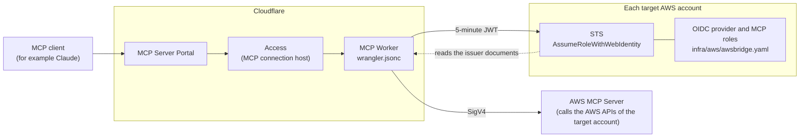

# awsbridge

English | [日本語](README_ja.md)

Bridge AI agents to AWS.

awsbridge turns the identity of a user authenticated by Cloudflare Access into per-user temporary AWS credentials. It runs as a Cloudflare Worker that is its own OIDC issuer: the Worker signs a short-lived JWT for the user, and AWS STS (`AssumeRoleWithWebIdentity`) exchanges it for credentials of a role in the target account. No long-lived AWS access keys are stored in the Worker.

> Early development stage. The design document is [docs/specs/architecture.md](docs/specs/architecture.md) (written in Japanese). Some steps below are marked as not run or not measured yet; take those as examples.

Predecessor: [youyo/aws-mcp-gateway](https://github.com/youyo/aws-mcp-gateway)

## What awsbridge does

awsbridge is an MCP relay (`src/index.ts`, [`wrangler.jsonc`](wrangler.jsonc)). It converts the identity of the user into per-user temporary AWS credentials (STS), signs requests with SigV4, and relays them to the AWS MCP Server. It is designed to sit behind a Cloudflare MCP Portal. The `aws_profile` argument switches between AWS accounts.

Each target account gets two MCP roles: the read-only `FederatedAwsBridgeMcpViewer` and the debug `FederatedAwsBridgeMcpDebugger` (see "AWS side (per target account)").

## Retiring console login and cleaning up

Console login has been removed from upstream. The MCP relay does not change: its settings, secret names, IAM OIDC provider and audience, stacks, and task names stay the same. If you only use the MCP relay, you have nothing to do.

The last version that still has console login is kept as the annotated tag `console-login-final` and the branch `archive/console-login`. The console login sections (setup, daily operations, stopping issuance, inventory) are in the README and the specs of the version at the tag `console-login-final`. To read them locally, for example:

```sh
git fetch upstream --tags && git show console-login-final:README.md
```

**If you ran console login in a downstream repository, you must clean up before you take the version without it.** The deployed console Worker, the Access applications, and the IAM OIDC provider and roles stay after the code is gone, and the roles keep trusting the console issuer. Merging the version without console login also removes the tools you need for cleanup (the stop, reconciliation, external check, and key tasks).

The order for a downstream repository:

1. Before anything else, do not pull upstream `main`. Fetch the tags and merge only up to the tag, then stop:

   ```sh
   git fetch upstream --tags && git merge console-login-final
   ```

2. Make your own backup tag in the downstream repository.
3. Clean up on that version: the cleanup outline and the commands of each step are in the README of the tag version (the section with the same heading as this one, and the sections it refers to).
4. Only after the cleanup is done, merge upstream `main`.

Do the cleanup in your downstream repository, not in a checkout of the upstream tag: it needs your downstream config, state files, and mise settings.

Rules (the step numbers are those of the cleanup outline in the README of the tag version):

- Do not give up the issuer host (the Worker, the Custom Domain, and the DNS records) until you have deleted the IAM OIDC provider and confirmed it is gone. While the provider exists, the roles trust that host by URL, so whoever gets the host can issue tokens that the roles accept.
- Do not wait a fixed time at any step. Finish a step when you have confirmed the denial or the absence (the wait before the revoke in step 2 is only a margin; the last reconciliation in step 3 confirms).
- If a stack deletion stops with `DeleteConflict`, the cause is an inline policy added outside CloudFormation. Remove the inline policies that are not for stopping first. Do not remove the stop policies (the revoke and the one-person-stop Deny) until the longest session of that role (`MaxSessionDuration`) has expired, counted from the later of the time you confirmed that new issuance is stopped (`503 login_disabled`) and the time of the last revoke (if you revoked again, the time of that one). Removing them earlier brings the sessions already issued and `aws login` back without a new login. Just before you remove them, confirm again that new issuance is not possible (`503 login_disabled`): while the provider still exists, only the Worker switch stops new issuance (the conditions for lifting a stop are in the specs of the tag version). Once that holds, remove them, retry the stack deletion right away and confirm the role is gone.
- If you cannot wait, leave the role whose deletion stopped in place with its stop policies attached. While such a role remains, the cleanup is not finished: add a Deny of `sts:AssumeRoleWithWebIdentity` to that role's trust policy ("Denying in the role trust policy" in the README of the tag version), and keep the issuer host until you have confirmed the provider is gone (the rule above stays). Not confirmed: whether such a role can keep the base StackSet from being deleted.

What is confirmed and what is not:

- Confirmed once in one personal test environment (confirm it again in each of your environments): the Custom Domain is deleted together with the Worker, and inline policies outside the template do not stop the deletion of the stack.
- Not confirmed: how long the sessions already issued and the `aws login` refresh tokens stay usable after the roles and the provider are deleted. Revoking and a Deny do not invalidate refresh tokens.
- This order has not been run end to end. Take it as an outline and check each step in your own environment.

## Upstream and downstream

This repository is the **upstream**. It is open source and holds only the code, the templates, the tools, and example configurations whose values are placeholders (`example.com`, `111111111111`). You do not run production from it.

Production runs from a private **downstream** repository: a clone of awsbridge that keeps awsbridge as the `upstream` remote and adds its own files. Real hosts, account IDs, emails, and keys live only there (and secrets only in gitignored files).

| | Upstream (this repository) | Downstream (private) |
|---|---|---|
| Holds | Workers, CloudFormation templates, reference Terraform, mise tasks, examples (`config/*.example.json`, `wrangler*.jsonc` with `example.com`) | `wrangler.<name>.jsonc`, `mise.<name>.toml`, `.miserc.toml`, `deploy/profiles.json` |
| Never holds | real hosts, account IDs, emails, keys | edits to upstream files (only new files, so `git pull` does not conflict) |
| Secrets | none | `mise.local.toml` and `.secrets/` (gitignored, never committed) |

The setup order for a downstream repository is in "Operating in a downstream repository".

## Architecture

The Cloudflare side (Workers) and the AWS side (CloudFormation) are completely separate. Deploying a Worker does not call AWS, and deploying CloudFormation does not call Cloudflare. For each target AWS account, you only need to run CloudFormation. An AWS account trusts an issuer only through its IAM OIDC provider, and each issuer host is served by one Worker.

The whole picture (the flow is detailed below):



### MCP relay

```
MCP client (for example Claude)
  │
  ▼
Cloudflare MCP Portal ─▶ Cloudflare Access (application on the connection host)
  │  https://awsbridge-mcp.example.com/mcp
  ▼
MCP Worker (wrangler.jsonc)
  │ 1. verify the Access JWT (ACCESS_AUD) and take the email
  │ 2. sign a 5-minute JWT with SIGNING_JWK (issuer = AWSBRIDGE_ISSUER)
  │ 3. STS AssumeRoleWithWebIdentity on the role of the selected aws_profile
  │ 4. sign the request with SigV4 and relay it
  ▼
AWS MCP Server ─▶ AWS APIs of the target account

STS reads https://awsbridge-oidc-mcp.example.com/.well-known/* (public; served by the same Worker)
Each target account: infra/aws/awsbridge.yaml (IAM OIDC provider + the two MCP roles)
```

### Hosts

| Host (example) | Worker | Purpose | Access |
|---|---|---|---|
| `awsbridge-mcp.example.com` | MCP | MCP connection (`/mcp`) | Protected. Its AUD is the Worker's `ACCESS_AUD` |
| `awsbridge-oidc-mcp.example.com` | MCP | MCP issuer (`/.well-known/*`) | Public (STS reads it). Any other path returns 401 |

- The production configuration (`env.prod` of the MCP Worker) uses Custom Domains on a zone of your Cloudflare account and sets `workers_dev` and `preview_urls` to `false`, which closes the entrances that skip Access. Only the trial configuration `env.dev` uses workers.dev.
- The `awsbridge-oidc-` prefix marks a host that is only an issuer and says whose it is, so that when another OIDC mechanism is later set up on the same domain, the owner of each issuer is clear.
- **An issuer host is what the IAM OIDC provider trusts.** Whoever takes it over can issue tokens that AWS accepts. Keep the domain's auto-renewal on, lock the domain at the registrar, and limit who can edit the zone (DNS, Routes, Custom Domains) and deploy the Workers.

## Operating in a downstream repository

Production use is expected to happen in a private downstream repository. You register awsbridge as `upstream` and keep pulling updates. **You never edit upstream files; you only add new files** to deploy to your own environment (so `git pull` does not conflict). In the following, `<name>` is the environment name (for example `awsbridge-mcp`).

### Order of the first setup

1. Create the downstream repository and add its files (steps 1 to 4 below).
2. MCP relay: follow "Order for the first deployment" in "MCP relay setup".
3. Once it is running, rotate the signing key on a fixed schedule with the steps in "Key rotation".

### Steps

1. Create the downstream repository and bring in the upstream.

```
git clone <awsbridge URL> my-awsbridge && cd my-awsbridge
git remote rename origin upstream
git remote add origin <private repository URL>   # The downstream push destination
```

2. Add `wrangler.<name>.jsonc` for the MCP Worker (commit it. Role ARNs are not secrets). Keep `main` and the others the same as the upstream `wrangler.jsonc`, and customize only `name` / `workers_dev` / `preview_urls` / `routes` / `alias`. `alias` replaces the module `awsbridge:profiles` with your profile list JSON (`deploy/profiles.json`, described right after the example). Do not use the env section (the values are dummies).

```jsonc
{
  "$schema": "node_modules/wrangler/config-schema.json",
  "name": "awsbridge-mcp",
  "main": "src/index.ts",
  "compatibility_date": "2026-07-21",
  "compatibility_flags": ["nodejs_compat"],
  "observability": { "enabled": true },
  "workers_dev": false,
  "preview_urls": false,
  "routes": [
    { "pattern": "awsbridge-mcp.example.com", "custom_domain": true },
    { "pattern": "awsbridge-oidc-mcp.example.com", "custom_domain": true }
  ],
  "alias": { "awsbridge:profiles": "./deploy/profiles.json" }
}
```

   `awsbridge-mcp.example.com` is the MCP connection host and `awsbridge-oidc-mcp.example.com` is the issuer host (`AWSBRIDGE_ISSUER=https://awsbridge-oidc-mcp.example.com`); replace both with your own domain. For a workers.dev trial, set `workers_dev` to `true` and remove `preview_urls` and `routes`.

   The format of `deploy/profiles.json` is the same as the JSON in "Multi-account" (commit it. Role ARNs are not secrets). Copying the upstream `config/profiles.example.json` and rewriting it is the quickest way.

3. Add the downstream mise config files: `mise.<name>.toml` and the `.miserc.toml` that enables it (commit both. Do not put secret values in them).

```toml
# mise.awsbridge-mcp.toml
[env]
AWSBRIDGE_WRANGLER_CONFIG = "wrangler.awsbridge-mcp.jsonc"
AWSBRIDGE_WRANGLER_ENV = ""                      # Empty = do not add --env (if unset, the upstream's dev is used)
AWSBRIDGE_STACK_NAME = "awsbridge-mcp"
AWSBRIDGE_KEY_FILE = ".secrets/awsbridge-mcp-signing-key.json"   # Use a separate key per environment
# AWS_PROFILE = "<AWS CLI profile used for deployment>"
# AWSBRIDGE_AUDIENCE = "awsbridge"               # If you change it, also match the Worker's var STS_AUDIENCE
```

```toml
# .miserc.toml
env = ["awsbridge-mcp"]
```

4. Write secret values and environment-specific values in `mise.local.toml` (gitignored. Do not commit it): `AWSBRIDGE_ISSUER` (the issuer URL, such as `https://awsbridge-oidc-mcp.example.com`), `AWSBRIDGE_ALLOWED_SUBJECTS`, `AWSBRIDGE_DEBUG_ALLOWED_SUBJECTS`, `AWSBRIDGE_ACCESS_TEAM_DOMAIN`, `AWSBRIDGE_ACCESS_AUD`, and so on (see "Variables in `mise.local.toml`"). The profile list goes in `deploy/profiles.json`, not in `mise.local.toml`.

5. Deploy the MCP relay (first time). The full order, including Cloudflare Access, is "Order for the first deployment" in "MCP relay setup".

```
mise run keygen                                               # Generate the signing key at AWSBRIDGE_KEY_FILE
AWSBRIDGE_WRANGLER_DEPLOY_MODE=deploy mise run deploy:worker  # First deployment with wrangler.<name>.jsonc (creates the Worker and its Custom Domains) → register secrets
AWS_PROFILE=<target> mise run deploy:aws                      # Deploy CloudFormation per account, and write the outputs ReadOnlyRoleArn / DebugRoleArn into deploy/profiles.json
mise run deploy:worker                                        # Bundle the profile list (default route)
```

6. Pull in upstream updates.

```
git pull --no-rebase upstream main
```

### Notes

- **Keep signing keys separate per environment.** Do not reuse the same key and the same issuer as the upstream's development deployment (use a different path for `AWSBRIDGE_KEY_FILE`). You can swap keys without downtime by following "Signing key rotation (MCP relay)" (`mise run key:prepare` → `secrets` → wait → `key:activate` → `secrets` → wait → `key:retire` → `secrets`).
- **The issuer (the issuer URL) differs per environment**, so the CloudFormation stack that creates the IAM OIDC provider and roles is also separate per environment (use different values of `AWSBRIDGE_STACK_NAME`). When placing multiple environments in the same account, also separate the role names (`AWSBRIDGE_READONLY_ROLE_NAME` / `AWSBRIDGE_DEBUG_ROLE_NAME`).
- mise gives `mise.<name>.toml` precedence over `mise.toml`, and `mise.local.toml` precedence over `mise.<name>.toml`. `.config/mise/conf.d/*.toml` loses to `mise.toml`, so it cannot be used.
- The upstream `wrangler.jsonc` (`name: awsbridge` / `env.dev`) is for the upstream's development use. Do not use it downstream.

### Setup skill (Claude Code)

A Claude Code skill that interactively sets up a downstream private repository is bundled in `.claude/skills/setup-downstream/` (`.agents/skills/setup-downstream/` links to the same file). You can use it as is just by cloning awsbridge (on first use you will be asked to trust the folder).

```
git clone https://github.com/youyo/awsbridge <downstream repository name>
cd <downstream repository name> && claude
/setup-downstream <downstream repository name>
```

The skill guides you in order through re-pointing the remotes (`origin` → `upstream`), creating the downstream repository, deploying the Worker, CloudFormation, Cloudflare Access/Portal, and verification. For operations that affect external systems, it asks for confirmation before running at each stage. The skill is version-controlled together with the code, so updates reach the downstream repository through `git pull --no-rebase upstream main`.

## How the Worker is deployed (default route and explicit route)

`scripts/wrangler.sh deploy` takes the **default route** unless you ask otherwise: `wrangler versions upload`, then it reads the Version ID from the output and runs `wrangler versions deploy <version-id>@100% --yes`. Only the code, vars and bindings of the Worker change. Custom Domains and Routes (triggers) are not synchronized, so the token needs no permission on the zone. A token that is "Individual Workers Editor for this one Worker, no zone permissions" is enough for daily deploys. How to create it is in [How to create the token for daily deploys](#how-to-create-the-token-for-daily-deploys).

`mise run deploy:worker` uses it for the MCP Worker.

- Why: a token with Workers Routes Write on the zone can add a Route to another Worker's Custom Domain host and take over its responses. Daily deploys therefore use a token without that permission.
- Arguments: `--var`, `--message`, `--tag`, `--outdir`, `--minify`, `--keep-vars` and the other options that `wrangler versions upload` accepts are passed on. `--config` and `--env` come from `AWSBRIDGE_WRANGLER_CONFIG` / `AWSBRIDGE_WRANGLER_ENV` as before. An option that `versions upload` does not accept (such as `--routes`) stops the script with an error; it is never dropped silently. If the Version ID cannot be read from the output, it exits 1 and does not run `versions deploy`.
- `deploy --dry-run` (used by the build tasks) still runs `wrangler deploy --dry-run`; nothing is written.
- **Explicit route**: set `AWSBRIDGE_WRANGLER_DEPLOY_MODE=deploy` to run `wrangler deploy`, which also synchronizes the triggers (Custom Domains, Routes) and the workers.dev / Preview URL settings. Use it for the first deployment (`versions upload` cannot create a Worker that does not exist yet) and whenever a Custom Domain or Route is added, changed or removed, including a change of `workers_dev` / `preview_urls`. Run it with a short-lived token of your own that has the zone permissions, and discard the token afterwards.

  ```
  AWSBRIDGE_WRANGLER_DEPLOY_MODE=deploy CLOUDFLARE_API_TOKEN=<short-lived token> mise run deploy:worker
  ```

- **Do not run `wrangler deploy` with a token that has no zone permissions.** It uploads the code first and fails only in the later triggers step, so the command exits with a failure code **even though the new code is already live**. Treat the failure as "deployed, but triggers not synchronized".
- `versions upload` does not change `workers_dev` or `preview_urls` of the Worker. These settings stay as the last explicit `wrangler deploy` set them, so make sure they are `false` there (the configurations in this repository fix both to `false`).
- A Worker's Custom Domains and Routes change only through the explicit route.

### How to create the token for daily deploys

The token "Individual Workers Editor for this one Worker, no zone permissions" is an account-owned API token with the Editor role on a single Worker. Editor can update and deploy an existing Worker (code, settings, versions), but cannot create or delete Workers ([Workers roles and permissions](https://developers.cloudflare.com/workers/authorization/workers/)).

What it can and cannot do (as the official documentation describes it):

- `wrangler deploy`, `wrangler versions upload` and `wrangler versions deploy` of an existing Worker need only Editor on that Worker (as the official documentation describes it). What happens when the default route of this repository runs with this token has not been checked in this repository.
- Creating a new Worker needs Admin on Workers as a whole. You cannot scope a token to a Worker that does not exist yet, so create the token after the first deployment (the explicit route above).
- Changing a Route needs Workers Routes Write on the zone. Custom Domains do not support per-Worker roles. Neither is possible with the daily token, which is the point.
- `wrangler login` (OAuth) does not support per-Worker scopes. Pass this token through the `CLOUDFLARE_API_TOKEN` and `CLOUDFLARE_ACCOUNT_ID` environment variables ([Workers authorization](https://developers.cloudflare.com/workers/authorization/)).

**Official route (dashboard)**: under Manage Account > Account API Tokens, create an account-owned token, set the scope to **Specified Workers**, select the Worker, and give it the **Editor** role ([changelog 2026-09-15](https://developers.cloudflare.com/changelog/post/2026-09-15-granular-worker-permissions/)). If you can do this, it is enough.

**Fallback route (API)**: if that screen does not let you select a Worker in your environment, you can create the token through the API. This does not mean the dashboard cannot do it.

1. Create a creator token. Give it only Account > Account API Tokens > Edit, and a short expiry (today). The API reference calls the permission `Account API Tokens Write` ([how to](https://developers.cloudflare.com/fundamentals/api/how-to/create-via-api/)). The token you create can only carry permissions within the creator's own. Put the value in the environment variable `CREATOR_TOKEN`; never write it on the command line. The examples below pass the header from the shell builtin `printf`, so the token is not on the curl command line (where other users could see it as a process argument) (bash, zsh).

   ```
   auth_header() { printf 'Authorization: Bearer %s\n' "$CREATOR_TOKEN"; }
   ```
2. Get the script tag. The resource takes the immutable `tag` of the Worker, not its name (`id` is the name).

   ```
   curl -sS -H @<(auth_header) \
     "https://api.cloudflare.com/client/v4/accounts/<account_id>/workers/scripts" \
     | jq '.result[] | select(.id == "<worker name>") | .tag'
   ```

   This list needs one of the Workers permissions (for example Workers Scripts Read). The creator token does not have it, so either use a token of your own that does, or add it to the creator token.

   [Workers scripts API](https://developers.cloudflare.com/api/resources/workers/subresources/scripts/methods/list/)
3. Get the permission group ID. Write the `id` in the policy, because the `name` can change. From the list, pick the group that means Editor on a single Worker (one with `is_selectable` true). A guide for what to look for is `Individual Workers Editor`, the permission the `List Worker Scripts` API reference lists as accepted.

   ```
   curl -sS -H @<(auth_header) \
     "https://api.cloudflare.com/client/v4/accounts/<account_id>/tokens/permission_groups" \
     | jq '.result[] | select(.name | test("Worker"; "i")) | {id, name, scopes, is_selectable}'
   ```

   [permission_groups API](https://developers.cloudflare.com/api/resources/accounts/subresources/tokens/subresources/permission_groups/methods/list/)
4. Create the token. Write the request body to `policy.json`.

   ```
   {
     "name": "<token_name>",
     "policies": [
       {
         "effect": "allow",
         "permission_groups": [{ "id": "<permission_group_id>" }],
         "resources": {
           "com.cloudflare.api.account.<account_id>": {
             "com.cloudflare.edge.worker.script.<script_tag>": "*"
           }
         }
       }
     ],
     "expires_on": "<expiry in UTC, e.g. 2027-01-31T00:00:00Z>"
   }
   ```

   The key `com.cloudflare.edge.worker.script.<script_tag>` is not in the official documentation. We confirmed in a user environment that a token can be created with this key. The keys the documentation does list are the account and zone forms, `com.cloudflare.api.account.…`.

   The value comes back in `result.value` of the response. Do not print it; write it straight to a file or a secret store. When you write it to a file, make it readable only by you from the moment it is created (`umask 077`; a later `chmod` leaves a window in which other users can read it).

   ```
   curl -sS -X POST -H @<(auth_header) \
     -H "Content-Type: application/json" --data @policy.json \
     "https://api.cloudflare.com/client/v4/accounts/<account_id>/tokens" \
     | (umask 077; jq -r '.result.value' > <destination>)
   ```

   [Create token API](https://developers.cloudflare.com/api/resources/accounts/subresources/tokens/methods/create/)
5. Check the scope. Put the new token in `DEPLOY_TOKEN` and run the following. For an account-owned token, `GET /accounts/<account_id>/tokens/verify` shows `active` and the expiry.

   - Reading the settings of the target Worker (`GET /accounts/<account_id>/workers/scripts/<worker name>/settings`) succeeds
   - Listing other Workers (`GET /accounts/<account_id>/workers/scripts`) returns 403, or returns only the target Worker (if you can see other Workers, the scope is too wide)
   - Listing Routes (`GET /zones/<zone_id>/workers/routes`) returns 403
   - Listing Custom Domains (`GET /accounts/<account_id>/workers/domains`) returns 403
6. Discard the creator token. In a user environment, the creator token could not delete itself. Delete it under Account API Tokens in the dashboard, or with another token that has Account API Tokens Write, and remove `CREATOR_TOKEN` from the environment. It expires soon anyway, but delete it first.

## MCP relay setup

### Prerequisites

- [mise](https://mise.jdx.dev/) (`mise install` installs the runtimes and cfn-lint)
- Cloudflare side: an account where you have run `wrangler login`
- AWS side: an AWS profile with permission to operate IAM and CloudFormation

### Decide the hosts (a custom domain is the basic form)

The Worker's issuer URL becomes the URL of the IAM OIDC provider, so decide the hosts first. The basic form puts the issuer and the MCP connection on separate hosts of your own domain (`example.com` below is a placeholder). One MCP Worker serves both, with two Custom Domains.

| Role | Example | Notes |
|---|---|---|
| OIDC issuer | `https://awsbridge-oidc-mcp.example.com` (no path) | `AWSBRIDGE_ISSUER`. STS reads `/.well-known/*` here, so it is public (an Access bypass if a wider Access application covers the host). Any other path, including `/mcp`, returns 401 here, because the Worker checks the Access JWT and requests to this host carry none |
| MCP connection | `https://awsbridge-mcp.example.com/mcp` | Where MCP clients connect. The Access application protects this host, and its AUD is the Worker's `ACCESS_AUD` |

- The Worker's configuration is `env.prod` in `wrangler.jsonc` (`routes` has the two `custom_domain` entries; `workers_dev` and `preview_urls` are `false`). Select it with `AWSBRIDGE_WRANGLER_ENV=prod`. A downstream repository copies it into its own `wrangler.<name>.jsonc` and replaces the hosts.
- The domain must be a zone on your Cloudflare account. Cloudflare creates the DNS records and certificates for the Custom Domains. Protect the issuer host as described in "Hosts".
- For a quick trial you can use workers.dev: the default `AWSBRIDGE_WRANGLER_ENV=dev` deploys `awsbridge-dev` to `https://<worker>.<subdomain>.workers.dev`, and that one host is both the issuer and the connection. Use a custom domain for real use.

### Order for the first deployment

The issuer URL becomes the OIDC issuer, so proceed in this order.

1. Cloudflare side: `mise run keygen` → set `AWSBRIDGE_ISSUER` (`https://awsbridge-oidc-mcp.example.com`), `AWSBRIDGE_WRANGLER_ENV` (`prod`) and the other variables in `mise.local.toml` → `cp config/profiles.example.json config/profiles.json` (required for the build. The contents can stay as dummies for now) → `AWSBRIDGE_WRANGLER_DEPLOY_MODE=deploy mise run deploy:worker` (the first deployment needs the explicit `deploy` route; see "How the Worker is deployed". This fixes the issuer URL. At this point the role ARNs are dummies, so `/mcp` is not usable). `deploy:worker` then runs `secrets`, which stops if `AWSBRIDGE_ACCESS_TEAM_DOMAIN` or `AWSBRIDGE_ACCESS_AUD` is empty; until the Access application exists in step 4, put a temporary value (for example `pending`) in `AWSBRIDGE_ACCESS_AUD`. `/mcp` returns 401 until you replace it.
2. AWS side: `AWS_PROFILE=<target> mise run deploy:aws` (note the outputs `ReadOnlyRoleArn` / `DebugRoleArn`)
3. Register the profile list. Write the role ARNs from the outputs into `config/profiles.json` (see "Multi-account") and run `mise run deploy:worker`. The list is a JSON file bundled into the Worker, not an environment variable, so the build fails without `config/profiles.json` (unset is an error)
4. Protect the connection host with Cloudflare Access (see `infra/cloudflare`): the application goes on `awsbridge-mcp.example.com` only, and `/.well-known/openid-configuration` and `/.well-known/jwks.json` on `awsbridge-oidc-mcp.example.com` stay public. Put the application's AUD in `AWSBRIDGE_ACCESS_AUD` and run `mise run secrets`. Then check that `/mcp` on `awsbridge-oidc-mcp.example.com` returns 401 and that workers.dev and Preview URLs do not answer.

```
mise run keygen                                               # Generate the signing key (.secrets/, not overwritten if it exists)
# Set AWSBRIDGE_ISSUER / AWSBRIDGE_ACCESS_* and others in mise.local.toml
cp config/profiles.example.json config/profiles.json          # The profile list (gitignored). Write the role ARNs
AWSBRIDGE_WRANGLER_DEPLOY_MODE=deploy mise run deploy:worker  # First time: wrangler deploy → secrets (does not call AWS)
mise run deploy:worker                                        # From then on: versions upload → versions deploy → secrets
```

From the second time on, deploy only the side you changed.

### AWS side (per target account)

Just deploy [infra/aws/awsbridge.yaml](infra/aws/awsbridge.yaml). It creates an IAM OIDC provider whose issuer is the Worker's issuer URL, and two roles that are assumed with the JWT issued by the Worker (read-only `FederatedAwsBridgeMcpViewer` and debug `FederatedAwsBridgeMcpDebugger`). Everyone can use the Viewer (`FederatedAwsBridgeMcpViewer`). Who gets the Debugger (`FederatedAwsBridgeMcpDebugger`) is decided by the downstream configuration (`DebugAllowedSubjects`); there is no upstream rule. Note when granting it: through remote shells and similar actions, the Debugger gets the permissions of the target's role, which carry no MCP-only condition.

```
AWS_PROFILE=<target> mise run deploy:aws    # Deploy CloudFormation (can be deployed to any number of accounts)
AWS_PROFILE=<target> mise run destroy:aws   # Clean up: delete the stack
```

A caller-supplied `AWS_PROFILE` takes precedence (`awsbridge` if unset). `AWSBRIDGE_STACK_NAME` / `AWSBRIDGE_AUDIENCE` can also be overridden with environment variables in the same way (their defaults live in `scripts/` and are not placed in `[env]` of `mise.toml`). On the other hand, values written in `mise.local.toml` or in a downstream repository's `mise.<name>.toml` take precedence over the caller's environment variables. If you want to switch the target account with `AWS_PROFILE=<target>`, do not write `AWS_PROFILE` in those files.

```
mise exec -- env AWS_PROFILE=<target> AWSBRIDGE_ALLOWED_SUBJECTS="user@example.com" AWSBRIDGE_DEBUG_ALLOWED_SUBJECTS="admin@example.com" bash scripts/deploy-aws.sh
```

You can also deploy the template directly from the management console or with StackSets. The parameters in that case:

| Parameter | Description |
|---|---|
| `IssuerHost` | The host of the OIDC issuer, that is, of `AWSBRIDGE_ISSUER` (without `https://` and without a trailing `/`. Example: `awsbridge-oidc-mcp.example.com`; for a workers.dev trial, `awsbridge-dev.example.workers.dev`) |
| `Audience` | The JWT audience (default `awsbridge`. Must match the Worker's `STS_AUDIENCE`) |
| `AllowedSubjects` | Users who can assume the read-only role (comma-separated. See the format below. Specify in lowercase) |
| `DebugAllowedSubjects` | Users who can assume the debug role (same format. Keeping it narrower than the read-only role is recommended) |
| `ReadOnlyRoleName` | Read-only role name (default `FederatedAwsBridgeMcpViewer`) |
| `DebugRoleName` | Debug role name (default `FederatedAwsBridgeMcpDebugger`) |
| `DebugAdditionalPolicyArns` | Optional. Additional managed policies to attach to the debug role (comma-separated. Nothing is attached if empty) |
| `DebugPassableEcsTaskRoleArns` | Optional. IAM role ARNs that may be passed to a task with `ecs:RunTask` (comma-separated. Wildcards are not allowed). If empty, `iam:PassRole` is not granted |
| `DebugPassableBedrockServiceRoleArns` | Optional. IAM role ARNs that may be passed to a Bedrock evaluation job or batch inference job with `bedrock:CreateEvaluationJob` / `CreateModelInvocationJob` (comma-separated. Wildcards are not allowed). If empty, `iam:PassRole` for Bedrock is not granted. List only roles dedicated to those jobs |

After deployment, note the outputs `ReadOnlyRoleArn` / `DebugRoleArn` (you can also get them with `aws cloudformation describe-stacks`).

#### Role permissions and caveats

| Role | Permissions |
|---|---|
| `FederatedAwsBridgeMcpViewer` | The AWS managed policy `ReadOnlyAccess` + an explicit Deny (unconditional) on retrieving SSM parameters (`ssm:GetParameter` / `GetParameters` / `GetParametersByPath` / `GetParameterHistory`) and Secrets Manager values (`secretsmanager:GetSecretValue` / `BatchGetSecretValue`) |
| `FederatedAwsBridgeMcpDebugger` | `ReadOnlyAccess` + an inline policy (enhanced read access for investigation, light operational actions, actions that incur cost, and connection and execution; every Allow is conditional on `aws:CalledViaAWSMCP = aws-mcp.amazonaws.com`; includes the same unconditional Deny on retrieving SSM parameters and Secrets Manager values) + the optional `DebugAdditionalPolicyArns` |

The debug role's inline policy is divided into the following groups (every Allow is conditional on `aws:CalledViaAWSMCP = aws-mcp.amazonaws.com`, with Resource `*`). It does not include delete actions, IAM changes, or organization changes (a Knowledge Bases sync can still remove indexed documents as a result; see `Operations`).

| Group (Sid) | Contents |
|---|---|
| `Investigation` | Reads for investigation that go deeper than `ReadOnlyAccess`. Logs Insights / log retrieval / Live Tail, X-Ray, CloudTrail (`LookupEvents` and queries), running Athena queries, EC2 console output / screenshots, AWS Config `SelectResourceConfig` / `GetResourceConfigHistory` |
| `DenySsmParameterRead` / `DenySecretsManagerRead` | **Deny** (no condition, the same as the read-only role): `ssm:GetParameter` / `GetParameters` / `GetParametersByPath` / `GetParameterHistory`, `secretsmanager:GetSecretValue` / `BatchGetSecretValue`. It applies to direct calls and to calls through AWS MCP alike, and also overrides any Allow in managed policies added with `DebugAdditionalPolicyArns`. `kms:Decrypt` is not granted (see the notes below) |
| `Operations` | Light operational actions with side effects (no delete APIs): ECS `UpdateService` / `StopTask`, starting, stopping, and rebooting EC2, changing Lambda concurrency, changing Auto Scaling capacity, rebooting RDS / ElastiCache, CloudFront `CreateInvalidation`, starting and stopping a Bedrock Knowledge Bases sync (`bedrock:StartIngestionJob` / `StopIngestionJob`). A sync is not a delete action, but documents removed from the data source (such as S3) are also removed from the vector store.<br>Stop, restart, and fail over: `states:StopExecution`, `glue:BatchStopJobRun` / `StopCrawler`, `codebuild:RetryBuild` / `StopBuild`, `autoscaling:SuspendProcesses` / `ResumeProcesses`, `rds:FailoverDBCluster` / `RebootDBCluster`, `elasticache:TestFailover`, `elasticbeanstalk:RestartAppServer`.<br>Stop or suppress: `cloudwatch:DisableAlarmActions` / `EnableAlarmActions`, `events:EnableRule` / `DisableRule` / `CancelReplay`, `autoscaling:SetInstanceHealth` / `EnterStandby` / `ExitStandby`, `rds:StartDBInstance` / `StopDBInstance` / `StartDBCluster` / `StopDBCluster`, `ssm:StopAutomationExecution`, `batch:CancelJob`, `codepipeline:StopPipelineExecution` |
| `CostIncurring` | Actions that **incur cost**: `bedrock:InvokeModel` / `InvokeModelWithResponseStream` (including Converse) / `ApplyGuardrail` / `RetrieveAndGenerate`, `sagemaker:InvokeEndpoint` / `InvokeEndpointAsync`, `rds:CreateDBSnapshot` / `CreateDBClusterSnapshot`, `ec2:CreateSnapshot`, `lambda:PutProvisionedConcurrencyConfig`. Bedrock evaluation, batch inference, and prompt optimization: `bedrock:OptimizePrompt`, `CreateEvaluationJob` / `StopEvaluationJob`, `CreateModelInvocationJob` / `StopModelInvocationJob`, `CreateAdvancedPromptOptimizationJob` / `StopAdvancedPromptOptimizationJob`. Transcribe: `transcribe:StartTranscriptionJob`. Permissions to share snapshots are not included |
| `Execution` | Connection and execution: `ssm:SendCommand` / `StartSession` and others, EC2 Instance Connect, `ecs:ExecuteCommand` / `RunTask`, `lambda:InvokeFunction`, `states:StartExecution`, `sqs:SendMessage`, `sns:Publish`, `rds-db:connect`. Running business logic and deployments: `states:RedriveExecution` / `StartSyncExecution`, `bedrock:InvokeAgent`, `lambda:InvokeFunctionUrl`, `glue:StartCrawler` / `StartWorkflowRun`, `ssm:StartAutomationExecution`, `events:StartReplay` / `PutEvents`, `codepipeline:RetryStageExecution`. `iam:PassRole` for `ecs:RunTask` is a separate Statement, granted only when `DebugPassableEcsTaskRoleArns` is specified; it limits the roles that can be passed to those ARNs and the recipient to `ecs-tasks.amazonaws.com` (if empty, only task definitions without a task role can be run) |
| `PassRoleForBedrockJobs` | `iam:PassRole` for `bedrock:CreateEvaluationJob` / `CreateModelInvocationJob`. A separate Statement, granted only when `DebugPassableBedrockServiceRoleArns` is specified; it limits the roles that can be passed to those ARNs and the recipient to `bedrock.amazonaws.com` (conditional on `aws:CalledViaAWSMCP` as well). Batch inference passes the roles listed in `DebugPassableBedrockServiceRoleArns`, just like evaluation jobs. `DataAccessRoleArn` of Transcribe (the form that passes a role) has no `iam:PassRole` to `transcribe.amazonaws.com`, so it cannot be used |

Athena queries also need a separate write permission (`s3:PutObject`) to the result bucket. This policy does not include it, so add it with `DebugAdditionalPolicyArns` if needed.

The Knowledge Bases sync actions (`bedrock:StartIngestionJob` / `StopIngestionJob`) also use Resource `*`, like the other groups. The debug role is meant to investigate any resource in the account, and the other actions (ECS, EC2, RDS, and so on) do not take target ARNs as parameters either, so there is no parameter to narrow them to Knowledge Base ARNs (`DebugAdditionalPolicyArns` only adds permissions and cannot narrow them). To narrow them, edit the `Operations` Resource in the template to `arn:${Partition}:bedrock:${Region}:${Account}:knowledge-base/${KnowledgeBaseId}`, or add an `aws:ResourceTag` condition.

- **The debug role includes permissions equivalent to remote execution.** `ssm:SendCommand` / `ssm:StartSession` / `ecs:ExecuteCommand` are equivalent to a remote shell, and secrets, credentials, and file contents may become visible (commands run with the instance or task role's permissions, which may be able to read secret values). `Operations`, as well as `lambda:InvokeFunction`, `states:StartExecution`, `sqs:SendMessage`, and `sns:Publish`, run processes with side effects.
- **The debug role includes actions that incur cost or run deployments.** Model and inference endpoint invocations, snapshot creation, and provisioned concurrency in `CostIncurring` are billed (`rds:StopDBInstance` can also create a snapshot). `codepipeline:RetryStageExecution` retries a failed stage and may run a production deployment. `events:StartReplay` / `PutEvents`, `bedrock:InvokeAgent`, `glue:StartCrawler` / `StartWorkflowRun`, and `ssm:StartAutomationExecution` run their targets, jobs, or automations. Depending on its settings, `glue:StartCrawler` deletes or deprecates catalog tables.
- **Bedrock evaluation jobs, batch inference, Advanced Prompt Optimization, and Transcribe jobs keep running after the session ends and are billed.** `bedrock:CreateEvaluationJob`, `CreateModelInvocationJob`, `CreateAdvancedPromptOptimizationJob`, and `transcribe:StartTranscriptionJob` start jobs that do not stop when the session is closed. Stopping them needs `bedrock:StopEvaluationJob` / `StopModelInvocationJob` / `StopAdvancedPromptOptimizationJob` (all granted). These Stop actions use Resource `*`, so they can also stop jobs that other people started, not only the jobs this session created; stopping a job does not refund the cost already incurred. Transcribe has no stop operation (only `DeleteTranscriptionJob`, which is not granted), so a started transcription job cannot be stopped from here. What can be passed to a Bedrock job is decided by "the roles listed in `DebugPassableBedrockServiceRoleArns` x the Create operations allowed here (`CreateEvaluationJob`, `CreateModelInvocationJob`)", and it is decided by the role's effective permissions, including what you add with `DebugAdditionalPolicyArns` and any Bedrock operation added in the future. Evaluation jobs and batch inference run with the permissions of the service role you pass, so through that role they can read data the debug role cannot read directly and write to any output location the role allows; the debug role's Deny on secret reads is not inherited by the service role. Make every listed role dedicated to those jobs and least-privilege (limit the input and output prefixes, the models, and KMS), and do not list an existing role with broad permissions. In the trust policy, use `aws:SourceAccount` and, where supported, `aws:SourceArn` as well (confirm that the key is provided for that job type). `aws:SourceAccount` only counters the confused deputy; it does not narrow what the service role itself can do, which must be limited separately.
- **Remember to undo stop and suppress actions.** Leaving `cloudwatch:DisableAlarmActions`, `events:DisableRule`, or `autoscaling:SuspendProcesses` / `EnterStandby` in place can hide incidents or stop self-healing. An instance marked Unhealthy with `autoscaling:SetInstanceHealth` is terminated and replaced.
- **The values in Secrets Manager and SSM Parameter Store cannot be read directly through the API (both roles).** Both roles deny `ssm:GetParameter` / `GetParameters` / `GetParametersByPath` / `GetParameterHistory` and `secretsmanager:GetSecretValue` / `BatchGetSecretValue` with no condition, so the Deny applies whether or not the call goes through AWS MCP. `ReadOnlyAccess` (v191) includes `ssm:Get*` (SecureString values with the `aws/ssm` key are also decrypted through the key policy), so without the Deny the session could read SSM parameters. `ReadOnlyAccess` does not include `secretsmanager:GetSecretValue` or `kms:Decrypt`, and the inline policy grants neither. Because an explicit Deny always wins, adding a managed policy with `DebugAdditionalPolicyArns` cannot bring these reads back.
- **No S3 write permission is granted to the debug role itself (no `s3:PutObject`), and what that means for the jobs (all not measured yet).** This is about the debug role only; it does not limit the service role you pass (see the previous item). Evaluation jobs (`CreateEvaluationJob`) and batch inference (`CreateModelInvocationJob`) read and write S3 with the service role you pass, so this role needs no S3 write; the input data has to be put into S3 by other means (another role). Advanced Prompt Optimization uses the permissions of the calling identity (Forward Access Session) for S3 and models: the AWS documentation (https://docs.aws.amazon.com/bedrock/latest/userguide/advanced-prompt-optimization-prereqs.html) says "using the permissions of your calling identity" and that the caller needs read access to the input and write access to the output location. So it is expected to fail to write its output with this role alone (the actual behavior is not measured); if you add `s3:PutObject` with `DebugAdditionalPolicyArns`, note that an additional managed policy does not automatically get the inline policy's MCP condition: limit it to the output bucket and prefix, and add the `aws:CalledViaAWSMCP` condition yourself. The permissions it really needs are not measured and may include more than writing the output. A Transcribe job (`StartTranscriptionJob`) with `OutputBucketName` is expected to be the same (not measured): the Amazon Transcribe guide ("Permissions required for IAM roles") describes the IAM entity that makes the request needing `s3:PutObject` on the output bucket, but it does not state whose identity is used. Without `OutputBucketName`, the transcript goes to a service-managed bucket and no write permission is needed.
- **Remaining unmeasured items (not verified against a real environment):** (1) whether `aws:CalledViaAWSMCP` is attached to the downstream calls that Advanced Prompt Optimization and Transcribe make with the caller's own permissions (Forward Access Session); (2) behavior with global inference profiles; (3) creating a job that needs `iam:PassRole`.
- **Some privilege escalation paths are closed, but not all (the remote shells below remain).** Granting `iam:PassRole` on `*` would let tasks run with any role, so it is not granted by default and is limited to the roles explicitly listed in `DebugPassableEcsTaskRoleArns` (ECS) and `DebugPassableBedrockServiceRoleArns` (Bedrock evaluation and batch inference jobs). Also, `lambda:UpdateFunctionConfiguration` (swapping the execution role or environment variables) and `autoscaling:UpdateAutoScalingGroup` (swapping the launch template) are not granted. `glue:StartJobRun` and `batch:SubmitJob` are not granted: overriding job arguments or the command and environment variables can run arbitrary code with the job's role (the same reason as `codebuild:StartBuild`). `codepipeline:StartPipelineExecution` is not granted either: `sourceRevisions` can swap the source commit, S3 object, or image, and `variables` can pass arbitrary values into the pipeline (the same reason `codebuild:StartBuild`, which can override its arguments, is not granted; use `RetryStageExecution` to re-run). `iam:PassRole` for `ssm:StartAutomationExecution` is not granted, so automations run only within the caller's permissions.
- **Remaining risk:** `ssm:SendCommand` / `ssm:StartSession` / `ecs:ExecuteCommand` / EC2 Instance Connect can act with the permissions of the role attached to the target instance or task. If a highly privileged instance or task exists in the same account, those permissions can be borrowed. In production, narrow the targets with tag conditions or SSM documents.
- **This does not mean that the roles cannot read secrets.** Paths other than those two APIs remain: remote shells (debug role: `ssm:SendCommand` / `StartSession`, `ecs:ExecuteCommand`, EC2 Instance Connect act with the instance or task role's permissions, which may read secret values), the output of SSM commands (`ssm:GetCommandInvocation` / `ListCommandInvocations`) and Automation executions, Lambda environment variables and the code download URL returned by `lambda:GetFunction`, plaintext environment variables in ECS task definitions and CodeBuild projects, EC2 user data, CloudFormation templates and outputs, AppConfig configuration content, S3 objects (`s3:GetObject`), logs, and `rds-db:connect` (debug role). Secret references in ECS (`secrets` / `valueFrom`) and CodeBuild (`SECRETS_MANAGER` / `PARAMETER_STORE` type) show only where the value is, not the value itself, unlike plaintext environment variables. Many of these paths are used routinely in investigations and are not denied. If secret values are stored there, narrow `AllowedSubjects` / `DebugAllowedSubjects`, or add your own Deny with a permissions boundary or an SCP.
- **`ReadOnlyAccess` is not pinned to a version.** It is an AWS managed policy, so AWS updates can change what it can read. The Deny above names the value-retrieval APIs explicitly, so that part is not affected by such updates.
- **`ReadOnlyAccess` is not limited to calls through MCP.** IAM conditions cannot be attached to AWS managed policies, so the read permissions remain valid even if you call the API directly with the session credentials. Only the Allows in the debug role's inline policy are restricted by `aws:CalledViaAWSMCP`.
- In production, narrow `Resource` to specific ARNs, tags, or SSM documents, and always enable session logs (SSM Session Manager logs, ECS Exec logs, Lambda CloudWatch Logs). CloudTrail alone is not enough.
- Users are separated per role by `AllowedSubjects` (read-only) and `DebugAllowedSubjects` (debug). Keep `DebugAllowedSubjects` narrower than the read-only list.

### Variables in `mise.local.toml`

Fixed defaults are in `mise.toml`. Account-specific values go in `mise.local.toml` (gitignored). All values are placeholders.

```toml
[env]
AWSBRIDGE_ISSUER = "https://awsbridge-oidc-mcp.example.com"             # The OIDC issuer (a dedicated host on your domain; no path). Not the MCP connection host awsbridge-mcp.example.com
AWSBRIDGE_WRANGLER_ENV = "prod"                               # env.prod of wrangler.jsonc (Custom Domains). The default is dev (workers.dev, for a trial)
AWSBRIDGE_ALLOWED_SUBJECTS = "user@example.com,*@example.org" # Users who can assume the read-only role (comma-separated)
AWSBRIDGE_DEBUG_ALLOWED_SUBJECTS = "admin@example.com"       # Users who can assume the debug role (comma-separated)
# AWSBRIDGE_READONLY_ROLE_NAME = "FederatedAwsBridgeMcpViewer"        # Optional. Role name (default value)
# AWSBRIDGE_DEBUG_ROLE_NAME = "FederatedAwsBridgeMcpDebugger"          # Optional. Role name (default value)
# AWSBRIDGE_DEBUG_ADDITIONAL_POLICY_ARNS = "arn:aws:iam::<account-id>:policy/<name>" # Optional. Additional managed policies for the debug role (comma-separated)
# AWSBRIDGE_DEBUG_PASSABLE_ECS_TASK_ROLE_ARNS = "arn:aws:iam::<account-id>:role/<name>"     # Optional. DebugPassableEcsTaskRoleArns
# AWSBRIDGE_DEBUG_PASSABLE_BEDROCK_SERVICE_ROLE_ARNS = "arn:aws:iam::<account-id>:role/<name>" # Optional. DebugPassableBedrockServiceRoleArns
AWSBRIDGE_POC_SUBJECT = "user@example.com"                   # The user used in the positive case of poc:sts (verification only)
AWSBRIDGE_ACCESS_TEAM_DOMAIN = "https://team.example.cloudflareaccess.com" # The Access team domain
AWSBRIDGE_ACCESS_AUD = "<AUD tag of the Access application>"   # The AUD of this application
```

Format of `AWSBRIDGE_ALLOWED_SUBJECTS` and `AWSBRIDGE_DEBUG_ALLOWED_SUBJECTS` (the same for both): each element takes the form `user@example.com` or `*@example.com`. A wildcard can be used only in the local part of the email; the domain part (`*@*` or `*@*.com`) and a bare `*` are not allowed (they would permit everyone). Empty elements and leading or trailing whitespace are also errors. Emails are normalized to lowercase before matching (the Worker lowercases the Access JWT's email before passing it to STS, and `deploy:aws` also lowercases these values before passing them to CloudFormation). `deploy:aws` validates this before calling AWS, and the CloudFormation template performs the same check with `AllowedPattern`.

The managed policies attached with `AWSBRIDGE_DEBUG_ADDITIONAL_POLICY_ARNS` become exactly the operations that a user who assumes the debug role can perform. Attach only the minimum necessary permissions (nothing is attached if unset).

Overridable defaults (filled in on the `scripts/` side. Can be changed with environment variables, `mise.local.toml`, or a downstream mise config file): `AWS_PROFILE` (`awsbridge`), `AWSBRIDGE_AUDIENCE` (`awsbridge`), `AWSBRIDGE_STACK_NAME` (`awsbridge`), `AWSBRIDGE_KEY_FILE` (`.secrets/dev-signing-key.json` at the repository root), `AWSBRIDGE_NEXT_KEY_FILE` / `AWSBRIDGE_PREVIOUS_KEY_FILE` (for key rotation. By default, `.next` / `.previous` is added before the extension of `AWSBRIDGE_KEY_FILE`), `AWSBRIDGE_WRANGLER_CONFIG` (`wrangler.jsonc`), `AWSBRIDGE_WRANGLER_ENV` (`dev` if unset. **If it is an empty string, `--env` is not added**), `AWSBRIDGE_WRANGLER_DEPLOY_MODE` (`versions` if unset; `deploy` for the explicit route).

### Worker configuration

Secrets (registered by `mise run secrets`): `SIGNING_JWK`, `ADDITIONAL_PUBLIC_JWKS` (optional. Additional public keys for signing key rotation. Normally `[]`), `ACCESS_TEAM_DOMAIN`, `ACCESS_AUD`. `secrets` can also be run on its own. It passes JSON to `wrangler secret bulk` via standard input, so values do not appear in command-line arguments. The profile list is not a secret (a Workers environment variable is limited to 5 KB each, and 270 profiles take about 38 KB); it is passed as a bundled JSON module (`awsbridge:profiles`; required. See "Multi-account").

Vars (optional. Only when overriding the defaults): `ISSUER` (set with `--var` at deploy time), `IDENTITY_CLAIM` (default `email`), `ACCESS_MAX_TOKEN_AGE_SECONDS`, `STS_AUDIENCE` (default `awsbridge`), `STS_REGION` (default `us-east-1`), `STS_ENDPOINT`, `AWS_MCP_REGION` (default `us-east-1`), `AWS_MCP_ENDPOINT`, `TARGET_AWS_REGION` (default `ap-northeast-1`), `ALLOWED_ORIGINS` (comma-separated exact-match origins. Empty by default).

As a CSRF countermeasure, `/mcp` rejects requests that carry an `Origin` header (that is, requests from a browser) with 403 `forbidden_origin` unless the origin is included in `ALLOWED_ORIGINS`. Server-to-server traffic from MCP clients and the Portal, which have no `Origin`, passes through. A POST is accepted only when `Content-Type` is `application/json` (parameters such as `; charset=utf-8` are allowed); anything else (including a missing Content-Type) results in 415 `unsupported_media_type`. Access verifies the browser's cookie and injects `Cf-Access-Jwt-Assertion`, so authentication alone cannot prevent CSRF.

Errors from `/mcp` are returned as `{"error":"<code>"}`: `unauthorized` (401), `forbidden` (403. No permission to assume the role), `upstream_auth_failed` (502. Server-side configuration inconsistency), `temporarily_unavailable` (503), `server_misconfigured` (500), `unknown_aws_profile` / `invalid_aws_profile` / `batch_not_supported` (400). For a table of responses by cause, see the section on the error to HTTP status mapping in `docs/specs/architecture.md`.

### Multi-account

You can switch between multiple AWS accounts with the `aws_profile` argument of MCP `tools/call`. The Worker directly assumes the selected account's role with AssumeRoleWithWebIdentity (no chaining). Who can use which account is determined by each account's trust policy (`AllowedSubjects` / `DebugAllowedSubjects`), and anything not permitted results in 403 `forbidden`.

1. For each target account, run `AWS_PROFILE=<target> mise run deploy:aws` and note the outputs `ReadOnlyRoleArn` / `DebugRoleArn`.
2. Write the profile list (required) in a JSON file. For the upstream's own development deployment, create it with `cp config/profiles.example.json config/profiles.json` (gitignored; values are placeholders). The list is not an environment variable: wrangler's `alias` bundles it into the Worker as the JSON module `awsbridge:profiles`, so there is practically no limit on the number of profiles (a Workers environment variable is limited to 5 KB each). Without the file, the build (`wrangler deploy` / `wrangler dev`) fails with `Cannot find module`. Writing `profiles` as an array is recommended. The order of the array becomes the order of the list returned by `list_aws_profiles` as-is (`default` is always first).

```json
{
  "default": "dev-readonly",
  "profiles": [
    { "name": "dev-readonly",  "roleArn": "arn:aws:iam::111111111111:role/FederatedAwsBridgeMcpViewer", "description": "development (read-only)" },
    { "name": "dev-debug",     "roleArn": "arn:aws:iam::111111111111:role/FederatedAwsBridgeMcpDebugger", "description": "development (debug)" },
    { "name": "prod-readonly", "roleArn": "arn:aws:iam::222222222222:role/FederatedAwsBridgeMcpViewer" },
    { "name": "prod-debug",    "roleArn": "arn:aws:iam::222222222222:role/FederatedAwsBridgeMcpDebugger" }
  ]
}
```

`profiles` can also be written as an object (`"profiles": { "dev-readonly": { "roleArn": "..." }, ... }`; the legacy format). However, the order of object keys is sometimes not preserved along the path to the Worker (the cause is unidentified. In a real environment, there was a case where `dev-readonly` → `dev-debug` was written but the Portal's enum ended up in name order). If you intend a particular order, write it as an array. In the array format, `name` is required, and duplicates result in 500 `server_misconfigured`.

- Profile names: 1 to 32 characters of alphanumerics, `_`, and `-` (exceeding that results in 500 `server_misconfigured`). Names consisting only of digits are ordered first in numeric order by the rules for objects, so avoid them if you intend a particular order.
- `default`: required. The profile used when `aws_profile` is omitted, and for requests other than `tools/call` such as `tools/list`.
- `tools`: optional. The tools that `aws_profile` applies to (all tools if omitted; omitting is normally fine). The names are the actual tool names returned by the AWS MCP Server (for example `aws___run_script`; you can check them with `tools/list`), and if you write a name that does not exist, `aws_profile` has no effect. An `aws_profile` attached to a tool that is not a target is ignored and removed.
- In the `tools/list` response, `inputSchema.properties.aws_profile` (`{type: "string", description}`; no `enum`, and the description contains neither the default nor any profile name) is injected into the target tools, and a `list_aws_profiles` tool is added (not on the second and later pages of a paginated `tools/list`). Clients (such as Claude) get the available profiles at run time by calling `list_aws_profiles`, which the Worker answers by itself after authentication (it returns `{default, profiles: [{name, description?}]}`, never a `roleArn`). Because the injected schema does not depend on the profile list, adding a profile needs neither a re-sync of the MCP Portal nor a reconnection of claude.ai. A re-sync and reconnection are needed only when the upstream tool set changes or when an awsbridge update changes the injected schema (including the first time you take in the update that removed the `enum` and added `list_aws_profiles`). Tools whose upstream definition already has `aws_profile` are not injected. If the response cannot be processed, it is returned as is.
- `aws_profile` is removed before being sent upstream. For a single `tools/call`, a name not in the list (`unknown_aws_profile`) or a non-string (`invalid_aws_profile`) is returned as HTTP 200 with a JSON-RPC result `isError: true` whose text contains the error code, the available profile names, and the default, so the client can correct it in one try. In a JSON-RPC batch, it results in 400 with `{"error": "<code>"}`.
- For a JSON-RPC batch, if the `aws_profile` of all target tools is the same (omitted means `default`), it is relayed with that role; if they differ, it results in 400 `batch_not_supported`.
- If the list is invalid (a format error, a duplicate, empty, and so on), the result is 500 `server_misconfigured` (the log shows only `config: invalid profiles: <kind>`, never the values). Unset makes the build fail.
- The STS `RoleSessionName` is `gw-<user>-<profile name>` (so you can tell them apart in CloudTrail).

A downstream repository does not edit the upstream `wrangler.jsonc`; its own `wrangler.<name>.jsonc` points `alias` at its own JSON (for example `deploy/profiles.json`) (see "Operating in a downstream repository"). For details, see the section on multi-account (aws_profile) in `docs/specs/architecture.md`.

## Key rotation

Rotate the signing key of the MCP Worker on a fixed schedule.

### Signing key rotation (MCP relay)

This is the procedure for replacing the MCP Worker's signing key (secret `SIGNING_JWK`) without downtime. STS caches the JWKS, so simply swapping the key would make verification fail right after the switch. Therefore, the new key's public key is first published in the JWKS (`/.well-known/jwks.json`), and signing is switched only after STS has picked it up.

```
mise run key:prepare    # 1. Generate the next key (AWSBRIDGE_NEXT_KEY_FILE. Aborts if it already exists)
mise run secrets        #    Publish the next key's public key in the JWKS (signing still uses the current key)
# ── Wait at least 1 hour (24 hours to be safe): until STS's JWKS cache expires ──
mise run key:activate   # 2. Current → PREVIOUS, NEXT → current
mise run secrets        #    Switch signing to the new key (the previous key's public key stays in the JWKS)
# ── Wait at least as long as the JWT lifetime (5 minutes) ──
mise run key:retire     # 3. Delete the previous key (PREVIOUS)
mise run secrets        #    Remove the old public key from the JWKS
```

- The length of STS's JWKS cache is not public, so the wait times are guidelines. The first wait is at least 1 hour, or 24 hours to be certain. The second wait is at least the JWT lifetime (5 minutes); also allow some margin for the `cache-control: max-age=300` of `/.well-known/jwks.json`.
- If the files `AWSBRIDGE_NEXT_KEY_FILE` / `AWSBRIDGE_PREVIOUS_KEY_FILE` (by default, `.next` / `.previous` added before the extension of `AWSBRIDGE_KEY_FILE`) exist, `mise run secrets` registers **only their public keys** in the secret `ADDITIONAL_PUBLIC_JWKS` (no private components go into the secret). If neither exists, it registers an empty array `[]` and clears the previous additional keys. Signing is always done only with `SIGNING_JWK` (the current key).
- Key files are created with mode 0600 and are never overwritten. Each task checks existence before acting and, if the conditions are not met, aborts without changing anything (`key:prepare`: NEXT already exists; `key:activate`: NEXT is missing or PREVIOUS already exists). `key:retire` does nothing if PREVIOUS is missing.
- If an **element** of `ADDITIONAL_PUBLIC_JWKS` is invalid (a short key, broken base64url, non-RSA, and so on), the Worker discards only that element, logs `jwks: invalid additional key skipped (index=<n>)` as a warning, and still returns the signing key's public key and the valid additional keys (the JWKS as a whole does not stop). If it is broken as JSON or is not an array, it returns 200 without additional keys. Only when `SIGNING_JWK` is invalid does it return 500 `server_misconfigured`. Note that STS cannot verify a signature made with a discarded key, so `mise run secrets` applies the same validation to the next / previous key files and stops without registering if they do not pass.
- For details of the mechanism, see the section on signing key rotation in `docs/specs/architecture.md`.

## Migrating an existing MCP deployment

These sections apply only to an MCP relay deployed with an older version of awsbridge.

### Migrating an existing deployment (`AWS_PROFILES` was removed)

`AWS_PROFILES` used to be passed as a var or a secret (`AWSBRIDGE_PROFILES` in `mise.local.toml`). It was removed, so migrate as follows.

```
# Upstream's development deployment: write the contents of AWSBRIDGE_PROFILES (a JSON string) in mise.local.toml into config/profiles.json
cp config/profiles.example.json config/profiles.json   # Replace the contents with your list. Delete AWSBRIDGE_PROFILES from mise.local.toml
# Downstream repository: move vars.AWS_PROFILES in wrangler.<name>.jsonc to deploy/profiles.json, delete the vars, and add alias
mise run deploy:worker
# Delete the Worker secret that is no longer needed (only if you kept it as a secret; match --config / --env to the ones you used)
bash scripts/wrangler.sh secret delete AWS_PROFILES
```

The Worker no longer reads a leftover `AWS_PROFILES` var or secret (it is ignored). A secret stays on the Worker, though, so remove it with `secret delete`.

### Migrating: default role names changed and the debug role narrowed

The default role names changed: `FederatedMcpReadOnly` → `FederatedAwsBridgeMcpViewer` and `FederatedMcpDebug` → `FederatedAwsBridgeMcpDebugger`. For a short time the default was `FederatedMcpViewer` / `FederatedMcpDebugger`; if your stack uses those, the same migration applies (the parameter names `ReadOnlyRoleName` / `DebugRoleName`, the outputs `ReadOnlyRoleArn` / `DebugRoleArn`, and the environment variables `AWSBRIDGE_READONLY_ROLE_NAME` / `AWSBRIDGE_DEBUG_ROLE_NAME` stay the same).

- **The old names are kept only when you update an existing stack with `scripts/deploy-aws.sh` and do not set the names.** `scripts/deploy-aws.sh` (`mise run deploy:aws`) runs `aws cloudformation deploy` and passes a role name only when its environment variable is set; for an existing stack, parameters that are not passed keep the stack's current values. In the following cases the roles are replaced, and their `roleArn` and unique ID change: (1) you set new names with `AWSBRIDGE_READONLY_ROLE_NAME` / `AWSBRIDGE_DEBUG_ROLE_NAME` (this is how you move to the new names); (2) you deploy the template some other way (the management console, `create-change-set` / `update-stack` without `UsePreviousValue`, StackSets, and so on), where parameters you do not give may take the template's defaults, that is, the new names; (3) you delete the stack and create it again.
- **Before migrating, preview the change.** Run `aws cloudformation deploy` with the same arguments as `scripts/deploy-aws.sh` plus `--no-execute-changeset`, then check with `aws cloudformation describe-change-set --stack-name <stack> --change-set-name <name> --query 'Changes[].ResourceChange.[LogicalResourceId,Action,Replacement]'` whether `ReadOnlyRole` / `DebugRole` show `Replacement: True`. A change set changes nothing unless you execute it; delete it afterwards with `aws cloudformation delete-change-set`.
- **Before migrating, check what refers to the old role ARNs:** KMS key policies, S3 bucket policies, SCPs, other roles' trust policies, and so on. Policies that name the old ARN stop matching the new role. A role in the `Principal` of a resource policy is stored by its unique ID, so after a replacement the trust does not come back even if the new role has the same name: update those policies.
- **Deleting the OIDC provider or changing a trust policy does not revoke STS credentials already issued.** Sessions of the old roles stay valid until they expire (the Worker requests 900 seconds; the upper limit is the role's `MaxSessionDuration`, 3600 seconds by default). To stop them at once, revoke the old roles' active sessions (IAM "Revoke active sessions") before deleting them.
- **Confirm deletions in IAM, not only in CloudFormation.** After deleting a stack, check in every target account that the roles and the OIDC provider are actually gone.
- **The debug role can no longer read secret values through the API.** `SecretRead` (`secretsmanager:GetSecretValue`, `ssm:GetParameter*`) and `SecretDecrypt` (`kms:Decrypt`) were removed, and both roles now deny those reads with no condition. This is a breaking change, and it cannot be undone with `DebugAdditionalPolicyArns` (an explicit Deny wins). It applies when you update the stack, whether or not you rename the roles.

#### Same stack (rename the roles; MCP fails during the switch)

1. Update the stack with the new names: `AWSBRIDGE_READONLY_ROLE_NAME=FederatedAwsBridgeMcpViewer AWSBRIDGE_DEBUG_ROLE_NAME=FederatedAwsBridgeMcpDebugger AWS_PROFILE=<target> mise run deploy:aws`. Note the new outputs `ReadOnlyRoleArn` / `DebugRoleArn`.
2. Update the `roleArn` values in the profile list (`config/profiles.json`, or `deploy/profiles.json` downstream).
3. Deploy the Worker: `mise run deploy:worker`.
4. Check that both roles work (call a tool with a read-only profile and a debug profile).

From step 1 until step 3 is done, MCP calls fail (the profile list still points at the old ARNs, which no longer exist).

#### Separate stack in parallel (when the issuer URL also changes)

If you also change the issuer URL (the issuer host), you can run a new stack next to the old one and switch with almost no downtime. Use values different from the old deployment for all three of: the issuer URL (`AWSBRIDGE_ISSUER`), the stack name (`AWSBRIDGE_STACK_NAME`), and the role names (`AWSBRIDGE_READONLY_ROLE_NAME` / `AWSBRIDGE_DEBUG_ROLE_NAME`). An account has only one IAM OIDC provider per URL, and role names are unique within an account, so if any of them is the same, the two stacks cannot coexist. No upstream code change is needed (all of them are already parameters).

Decide these before you start:

- **Deleting the old stack is part of the migration. Set a deadline for it.** The old debug role keeps `SecretRead` until its stack is deleted, so "secret values cannot be read directly through the API" does not hold until then.
- **Whether the old and new deployments share the signing key.** If they share it, a leaked key still reaches the old roles (including the old debug role that can read secret values) until the old stack is deleted, so the deadline matters even more. If you separate them, point `AWSBRIDGE_KEY_FILE` at a new file and run `mise run keygen` for the new deployment; this is a chance to renew the key (see "Signing key rotation (MCP relay)" for the existing procedure).
- **A new URL also changes the Cloudflare Access application (AUD) and the MCP clients' server URL.** Protect the new connection host with an Access application and keep `/.well-known/*` public on the new issuer host (see `infra/cloudflare` and "Decide the hosts"), and set the new Worker's `ACCESS_AUD` (`AWSBRIDGE_ACCESS_AUD`) to the new application's AUD. The Worker verifies the Access JWT against `ACCESS_AUD` itself, so a request that reaches it without passing Access (the issuer host, another host, a Preview URL) gets 401; check this on the new hosts too (for example, `/mcp` on the issuer host returns 401). Keep workers.dev and Preview URLs closed (`workers_dev` and `preview_urls` set to `false`, as in the custom domain form).

Steps (the Worker comes first: IAM reads the issuer's `/.well-known/openid-configuration` when it creates the OIDC provider, as on the first deployment):

1. Deploy a second Worker under another name that answers at the new URL, with `ISSUER` set to the new URL (for example another wrangler config via `AWSBRIDGE_WRANGLER_CONFIG` / `AWSBRIDGE_WRANGLER_ENV`, and `AWSBRIDGE_ISSUER` set to the new URL; `mise run deploy:worker` passes `ISSUER` and bundles the profile list in the same deploy. A new Worker needs the explicit route, `AWSBRIDGE_WRANGLER_DEPLOY_MODE=deploy`). STS fetches the discovery document and the JWKS from the issuer URL, and the discovery document's issuer is the Worker's `ISSUER`. A Worker has only one `ISSUER`, so the old Worker cannot serve the new issuer: running both side by side needs this second Worker. Its profile list can hold dummies at this point, as on the first deployment.
2. Deploy the new stack with `mise run deploy:aws`, setting the new `AWSBRIDGE_ISSUER`, `AWSBRIDGE_STACK_NAME`, and role names. Do this in every target account.
3. Write the new `roleArn` values in the new Worker's profile list and deploy it again.
4. Before switching the clients, confirm once that the new roles can be assumed: `AWSBRIDGE_ISSUER=<new URL> AWSBRIDGE_STACK_NAME=<new stack> AWS_PROFILE=<target> mise run poc:sts` (it signs a JWT with `AWSBRIDGE_KEY_FILE`, which must be the key of the Worker at the new URL; for the debug role, pass `--role-arn <DebugRoleArn>`).
5. Change the MCP clients' server URL to the new connection URL (`https://<connection host>/mcp`; it differs from the issuer URL when you use separate hosts, as in "Decide the hosts"). The connection URL and the Access application are new, so clients need to be reconfigured and authorized again.
6. Check that both roles work.
7. By the deadline, delete the old stack in every account (`AWSBRIDGE_STACK_NAME=<old stack> AWS_PROFILE=<target> mise run destroy:aws`). This removes the old OIDC provider and roles. Confirm in IAM that they are gone in every account.
8. Only after the old OIDC provider is gone from every account, remove the old Worker and give up the old issuer host name (the domain, or the workers.dev subdomain). In the reverse order, if a third party takes over the released host name, a remaining provider would trust it as an issuer.

This way you can check the old and new deployments side by side before you switch. Without a second Worker this is not a parallel migration: the new stack can be created only after the Worker's `ISSUER` has moved to the new URL, and from then until the new stack and the new `roleArn` values are deployed, MCP calls fail (the old roles no longer accept the Worker's tokens). If you do it that way, prepare the rollback first (redeploy the Worker with the old `ISSUER` and the old `roleArn` values; keep the old stack until the new one works).

## Development

Runtimes and commands are managed with [mise](https://mise.jdx.dev/). `mise tasks` lists every task.

```
mise install            # runtimes and tools (node, pnpm, cfn-lint, terraform, tflint, gitleaks)
mise run install        # dependencies (pnpm install)
mise run test           # unit + e2e (test:unit / test:e2e; the e2e tests start wrangler dev)
mise run lint           # biome, type check, cfn-lint on the CloudFormation templates, Terraform samples
mise run fmt            # format
mise run build          # bundle the MCP Worker without deploying
mise run dev            # run the MCP Worker locally
mise run secrets:scan   # gitleaks on the commit history and the working tree
```

For verification only: the `poc:*` tasks call real AWS or Cloudflare and are used only when you run them explicitly (for example `mise run poc:sts`: one positive and four negative cases of `AssumeRoleWithWebIdentity` with a JWT signed by the MCP key).
